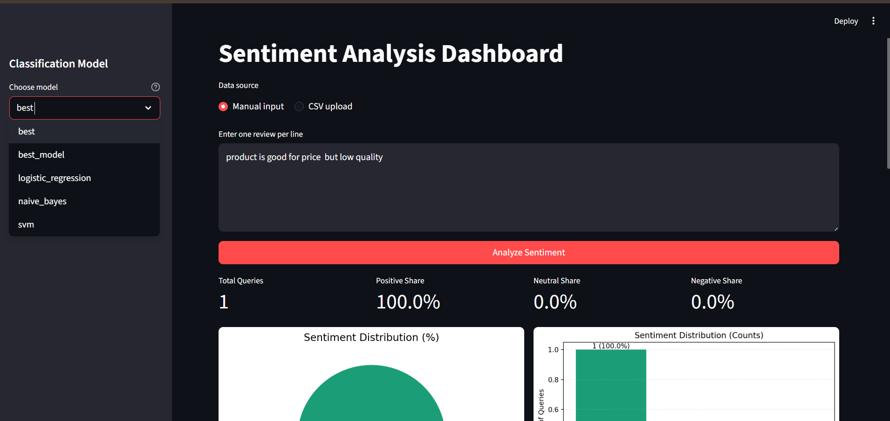
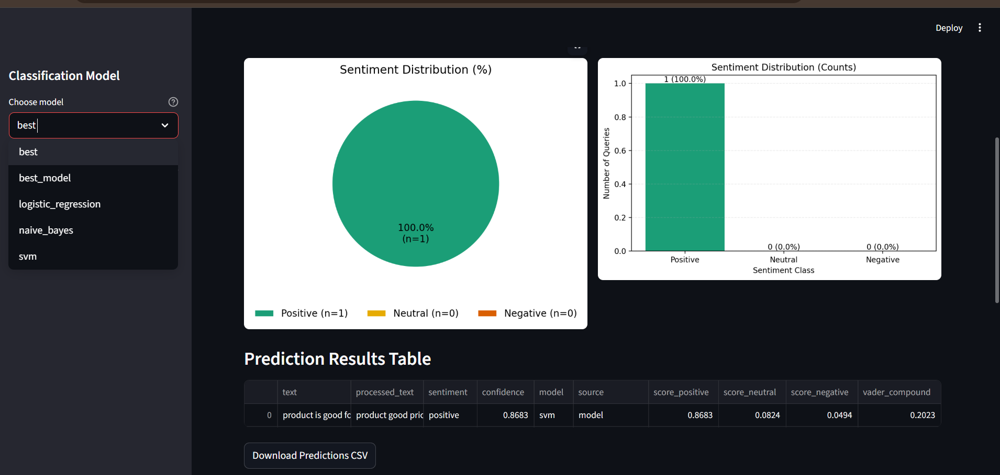

# Sentiment Analysis Dashboard

A Python project for classifying short text as positive, neutral, or negative. It includes text preprocessing, training code for traditional machine-learning models, and a Streamlit dashboard for manual input or CSV uploads.

[Watch the dashboard demo](https://youtu.be/Zb4HXzh-gXI)





## What the project includes

- Text preprocessing and feature extraction, including TF-IDF
- Training code for Naive Bayes, logistic regression, and SVM, with an optional LSTM path
- A Streamlit dashboard that accepts typed text or a CSV file and summarizes predictions
- A saved training report at `sentiment_analysis/models/training_report.json`

The training report records a 1,176-row run and names SVM as the selected model, but it does not include evaluation metrics. The dataset and trained model files are not included in this repository, so this README does not quote accuracy or F1 scores. When model artifacts are absent, the dashboard uses the predictor’s fallback behavior; treat those outputs as a demo, not as evaluated model predictions.

## Run the dashboard

Python 3.10 or 3.11 is recommended for the optional TensorFlow/LSTM path.

```bash
python -m venv .venv
source .venv/bin/activate  # Activate the environment before continuing
python -m pip install -r sentiment_analysis/requirements.txt
streamlit run streamlit_app.py
```

## Train models

The repository includes a small built-in sample for a basic pipeline smoke test:

```bash
python -m sentiment_analysis.train --dataset twitter --no-lstm
```

For a real experiment, supply a local CSV, ZIP, or Excel dataset using `--data-path`. Supported dataset schemas are described in `src/data_loader.py`. Dataset files and generated model artifacts are excluded from Git; do not add private or licensed data unless you have permission to publish it.

```bash
python -m sentiment_analysis.train --dataset amazon --data-path data/amazon_reviews.csv --no-lstm
```

## Repository map

```text
sentiment_analysis/        configuration, training, and prediction code
src/                       preprocessing, feature extraction, and models
streamlit_app.py           Streamlit dashboard
sentiment_analysis/models/ training report; generated model files are local
docs/images/               dashboard screenshots
```

## Scope

This is a learning project. Results depend on the dataset, class balance, preprocessing, and evaluation setup. Review the training data and model metrics before using the classifier outside a demonstration.
